# ChargeGrid Intelligence
### Sistema Integrado de Gestão Comercial de Eletropostos

**GoodWe EV Challenge 2026 — FIAP | 1CCR — Equipe 04 — Sprint 4**

## Integrantes

| Nome | RM |
|------|----|
| Gabriela Angel Silva | 570808 |
| Izabelly Menezes | 570673 |
| Marcos Paulo Sampaio | 573987 |
| Otávio Santos | 570225 |
| Tiago Muhlmann | 569569 |
| Wesley Marques | 573915 |

**Curso:** Ciência da Computação — 1º Ano | **Instituição:** FIAP

---

## Sumário

1. [Contexto e Motivação](#1-contexto-e-motivação)
2. [Problema Central](#2-problema-central)
3. [Solução Proposta — Os Quatro Pilares](#3-solução-proposta--os-quatro-pilares)
4. [Arquitetura do Sistema (Sprint 4)](#4-arquitetura-do-sistema-sprint-4)
5. [Estrutura do Repositório](#5-estrutura-do-repositório)
6. [Como Executar (Linux, macOS e Windows)](#6-como-executar-linux-macos-e-windows)
7. [Sprint 4 — O que foi construído](#7-sprint-4--o-que-foi-construído)
8. [Resultados quantitativos](#8-resultados-quantitativos)
9. [Resultados qualitativos](#9-resultados-qualitativos)
10. [Alinhamento com a GoodWe](#10-alinhamento-com-a-goodwe)
11. [Conexão com os Conteúdos da Disciplina](#11-conexão-com-os-conteúdos-da-disciplina)
12. [Avaliação crítica: sustentabilidade e inovação](#12-avaliação-crítica-sustentabilidade-e-inovação)
13. [Riscos e Limitações Reconhecidas](#13-riscos-e-limitações-reconhecidas)
14. [Histórico das Sprints 2 e 3 e Roadmap](#14-histórico-das-sprints-2-e-3-e-roadmap)
15. [Referências](#15-referências)

---

## 1. Contexto e Motivação

O Brasil vive um momento de inflexão no setor de mobilidade elétrica. Em 2025 o mercado de veículos elétricos e híbridos plug-in registrou **223.912 unidades vendidas** (+26% em relação a 2024), e os dois primeiros meses de 2026 já somaram **48.591 emplacamentos** — 90% a mais que no mesmo bimestre de 2025. O país acumula mais de 350 mil veículos plug-in em circulação e **16.880 eletropostos** públicos e semipúblicos, expansão de ~290% desde 2023.

Esse crescimento acelerado expõe um gargalo estrutural: a infraestrutura de recarga comercial (shoppings, supermercados, postos, estacionamentos) carece de **inteligência operacional**. O hardware evoluiu; os sistemas de gestão de potência, faturamento e monitoramento em tempo real não acompanharam. Cada sessão de recarga é um evento rico em dados que raramente é capturado, analisado e transformado em valor.

Nesse cenário, a parceria FIAP × GoodWe originou o **EV Challenge 2026**, desafio acadêmico que propõe aos alunos do 1º ano o desenvolvimento de soluções reais para gestão inteligente de eletropostos comerciais.

## 2. Problema Central

A ausência de mecanismos integrados capazes de orquestrar potência, registrar ciclos de recarga, faturar automaticamente e se comunicar com sistemas externos se traduz em cinco disfunções, cada uma endereçada por um ou mais dos quatro pilares do projeto:

| Problema | Conexão com os pilares |
|---|---|
| **Sobrecarga em horários de pico** — usuários carregam predominantemente à tarde/noite, sobrepondo picos residenciais e comerciais | Controle de Demanda (gestão em tempo real) + IA (previsão antecipada) + Tarifação (preço dinâmico redistribui a demanda) |
| **Falta de padronização** — cada fabricante usa protocolo proprietário; trocar de plataforma custa 3–5× mais | Protocolos Abertos (OCPP/MODBUS como requisito arquitetural) |
| **Complexidade de cobrança** — tarifa pode variar durante a própria sessão; ~40% dos usuários já pagaram valor diferente do esperado | Tarifação e Pagamento |
| **Experiência do usuário** — falta de informação antecipada sobre preço/disponibilidade, ausência de feedback em tempo real | Todos os quatro pilares |
| **Ineficiência energética** — capacidade instalada subutilizada fora do pico, picos desnecessários por falta de gestão | IA (planejamento antecipado) + Controle de Demanda (correção em tempo real) |

Um estabelecimento com 20 carregadores de 22 kW pode demandar até 440 kW simultâneos no pior caso — muito acima do tipicamente contratado. Sem gestão ativa, isso significa multas por ultrapassagem de demanda ou racionamento arbitrário entre usuários.

### Objetivo do projeto

Projetar e prototipar um sistema de orquestração capaz de: **(a)** controlar dinamicamente a potência por ponto de carga respeitando a demanda contratada; **(b)** integrar equipamentos de fabricantes diferentes via OCPP/MODBUS; **(c)** automatizar o faturamento das sessões; **(d)** aplicar IA para prever picos e otimizar a alocação de potência.

## 3. Solução Proposta — Os Quatro Pilares

```
┌─────────────────────────────────────────────────────────┐
│                  ChargeGrid Intelligence                │
├──────────────┬──────────────┬──────────────┬────────────┤
│  Controle de │  Protocolos  │  Tarifação e │     IA     │
│   Demanda    │    Abertos   │  Pagamento   │  Preditiva │
│              │  OCPP/MODBUS │              │            │
└──────────────┴──────────────┴──────────────┴────────────┘
```

**Controle Dinâmico de Potência** — define um orçamento de potência para o site (ex: 100 kW) e redistribui automaticamente entre carregadores ativos a cada conexão/desconexão, sem jamais ultrapassar o limite contratado.

**Protocolos Abertos (OCPP + MODBUS)** — comunica-se com o hardware via padrões abertos em vez de SDKs proprietários. O mercado de plataformas OCPP movimentou US$ 1,47 bi em 2024 (+22,8% a.a.); operadores presos a sistemas proprietários enfrentam custos de migração 3–5× maiores.

**Tarifação e Pagamento** — cobrança automática por kWh consumido, com tarifa que varia por horário/condição da rede. Amparada pela Resolução ANEEL nº 1.000/2021, que permite preços livremente negociados na recarga comercial.

**Inteligência Artificial** — três funções: **interpretação** (traduzir eventos OCPP/MODBUS em eventos semânticos), **preditividade** (antecipar picos de demanda) e **conversão** (insights em linguagem natural para o operador).

## 4. Arquitetura do Sistema (Sprint 4)

Dois processos HTTP independentes (padrão *Backend for Frontend*), mais o hardware — real ou simulado — falando Modbus TCP. **Toda a regra de negócio vive no backend**; o frontend só apresenta.

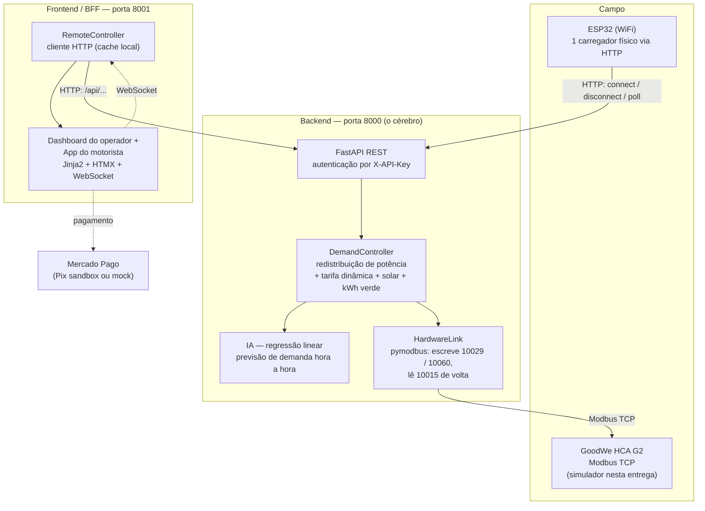

### A cadeia de decisão que a Sprint 4 fechou

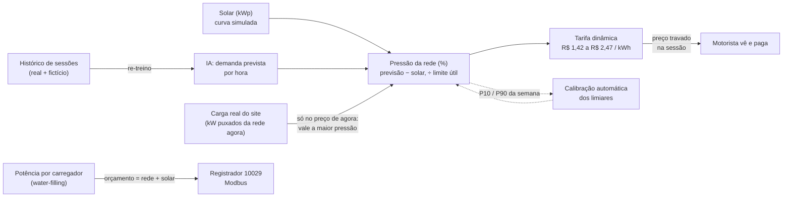

### Fluxo de uma conexão

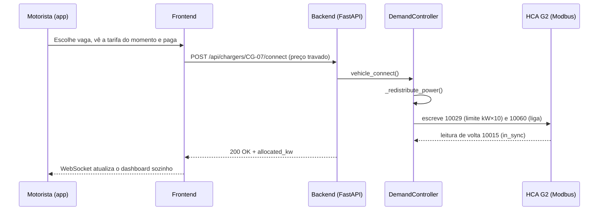

### Por que a arquitetura é desacoplada
O `DemandController` expõe apenas `_state_snapshot()` — um dicionário Python puro, sem conhecer HTTP, terminal ou web. Foi isso que permitiu, da Sprint 2 à 4, trocar a apresentação (terminal → API + dashboard) e ligar o hardware (HTTP → Modbus) **sem reescrever a lógica central**. O `HardwareLink` segue o mesmo princípio: o controlador só diz "este carregador pode receber X kW"; trocar o simulador pelo equipamento real é mudar `HARDWARE_HOST`/`HARDWARE_PORT`.

## 5. Estrutura do Repositório

```
chargegrid/
├── run.sh / run.bat           ← sobem o projeto inteiro (Linux/macOS e Windows)
├── LICENSE                    ← MIT
├── docs/
│   ├── experimento/           ← gráficos e resultados.json do experimento (seção 8.3)
│   ├── img/                   ← capturas de tela usadas neste README
│   ├── roteiro_video.md       ← roteiro do vídeo técnico (≤ 5 min)
│   └── entrega.txt            ← integrantes/RMs e links da entrega
│
├── backend/                   ← o "cérebro" (porta 8000)
│   ├── main.py                # FastAPI + loop de energia (1 s) + chave de API
│   ├── requirements.txt       # versões fixadas · requirements-dev.txt: testes e gráficos
│   ├── core/
│   │   ├── demand_controller.py  # redistribuição, tarifa, solar, kWh verde, séries de faturamento
│   │   ├── tariff.py             # TariffConfig, multiplicador e preço
│   │   ├── solar.py              # curva fotovoltaica simulada + fator de emissão
│   │   ├── hardware.py           # HardwareLink (Modbus TCP, timeout + cooldown)
│   │   ├── modbus_map.py         # mapa de registradores do GoodWe HCA G2
│   │   ├── auth.py               # chave de API
│   │   └── state.py              # instância única do controller (12 carregadores)
│   ├── routers/                  # chargers, predictions, settings, tariff, solar, hardware, billing
│   ├── ai/                       # histórico sintético, features, treino, previsão
│   ├── simulator/hca_g2_sim.py   # simulador Modbus TCP do HCA G2 (1 escravo por carregador)
│   ├── scripts/experimento_tarifa.py  # experimento COM x SEM tarifa dinâmica
│   ├── simulate_esp32.py         # simula o ESP32 via HTTP
│   └── tests/                    # 48 testes (pytest)
│
└── frontend/                  ← dashboard do operador + app do motorista (porta 8001)
    ├── .env.example
    ├── requirements.txt
    ├── backend/                   # main.py, remote_controller.py, security.py (scrypt),
    │                              # payments.py, demo_seed.py, chatbot.py, templates/, static/
    ├── scripts/                   # seed_demo.py, demo_scenario.py, demo_api.py
    └── tests/                     # 18 testes (pytest)
```

## 6. Como Executar (Linux, macOS e Windows)

Pré-requisito: **Python 3.11+** (`python3 --version`; no Windows, `python --version`).

| Sistema | Comando |
|---|---|
| Linux / macOS | `./run.sh` |
| Windows | duplo clique em `run.bat` (ou `run.bat` no Prompt de Comando) |

Na primeira vez o script cria os dois `venv`, instala as dependências (versões fixadas), treina o modelo de IA, cria `frontend/.env` a partir do `.env.example` (**`PAYMENT_MODE=mock`**: pagamento simulado, sem credenciais) e sobe os dois servidores. Depois disso, o frontend cadastra sozinho os 12 clientes fictícios, importa 60 dias de histórico e re-treina a IA com ele.

- **http://127.0.0.1:8001** — entrada: "Sou cliente" (app do motorista) ou "Sou empresa" (dashboard)
- **http://127.0.0.1:8000/docs** — API do backend (Swagger)

| Perfil | Onde entrar | Credenciais |
|---|---|---|
| Empresa (operador) | `/empresa/login` | `contato@chargegrid.com` / `demo123` |
| Cliente (motorista) | `/cliente/login` | CPF + senha `demo123` — CPFs na tela **Clientes** ou em `seed_demo.py --listar` |

Nomes, CPFs (válidos só no dígito verificador) e e-mails são inventados.

### Com o hardware simulado (Modbus TCP)

```bash
HARDWARE_MODE=modbus ./run.sh        # Windows:  set HARDWARE_MODE=modbus  e depois  run.bat
```
Sobe o simulador do HCA G2 na porta 5020 e o backend passa a escrever o limite de potência de cada carregador no registrador `10029` (e liga/desliga no `10060`). Para conferir o que foi escrito e lido de volta: `GET /api/hardware` (campo `in_sync`). O terminal do operador mostra erros de rede como evento `MODBUS_ERROR` e o controle continua em memória.

### Segurança em execução
O `run.sh`/`run.bat` geram uma `CHARGEGRID_API_KEY` aleatória a cada execução (toda rota da API exige o cabeçalho `X-API-Key`) e imprimem o `export` para quem for rodar scripts à parte. Senhas são guardadas com hash scrypt + salt.

### Scripts de demonstração e de avaliação

```bash
# em outro terminal, com o projeto no ar (e a CHARGEGRID_API_KEY exportada)
cd backend  && venv/bin/python simulate_esp32.py                 # ESP32 simulado via HTTP
cd frontend && venv/bin/python scripts/demo_scenario.py          # roteiro de 3 fases ao vivo
cd frontend && venv/bin/python scripts/seed_demo.py --listar     # clientes fictícios e logins

# testes automatizados
cd backend  && venv/bin/pip install -r requirements-dev.txt && venv/bin/python -m pytest -q     # 48 testes
cd frontend && venv/bin/python -m pytest -q tests                                              # 18 testes

# experimento COM x SEM tarifa dinâmica (gera docs/experimento/*)
cd backend  && venv/bin/python -m scripts.experimento_tarifa
```
(No Windows troque `venv/bin/python` por `venv\Scripts\python`.)

### Pagamento Pix real (opcional)
Edite `frontend/.env` com `PAYMENT_MODE=mercadopago`, `MP_ACCESS_TOKEN` e `MP_PUBLIC_KEY` (credenciais de **teste** do Mercado Pago) e reinicie. O `.env` não é versionado. `DEMO_MODE=0` desliga clientes fictícios, histórico e rotas `/demo/*`.

## 7. Sprint 4 — O que foi construído

A Sprint 3 deixou um sistema que **controla** potência. A Sprint 4 o torna **inteligente, sustentável e conectado a hardware**:

**1. Tarifa dinâmica movida pela IA (demand response).** O modelo prevê a demanda de cada hora e essa previsão vira preço: quanto mais pressionada a rede, mais caro o kWh. O preço fica entre **R$ 1,42 e R$ 2,47/kWh** com base de R$ 1,90 — dentro da faixa de mercado pesquisada (recarga rápida pública R$ 1,80–2,50). O preço é **travado no início da sessão**: o que o motorista viu é o que paga, mesmo que a tarifa mude durante a recarga. Os limiares de pressão (a partir de que nível a rede é "tranquila" ou "cheia") são **calibrados pela própria IA** (percentis 10 e 90 da demanda prevista para a semana), sem o operador precisar entender de pressão; ele pode forçar valores manuais e voltar ao automático. O cálculo completo está em [7.1](#71-como-o-preço-do-kwh-é-calculado).

**2. Energia solar simulada e kWh verde.** Curva fotovoltaica de 6h às 18h (40 kWp padrão, sem bateria). O solar soma ao orçamento de potência dos carregadores e alivia a rede (o que também baixa a tarifa). Cada sessão acumula `green_kwh` (a fatia atendida pelo solar) e o painel mostra a parcela verde e o CO₂ evitado.

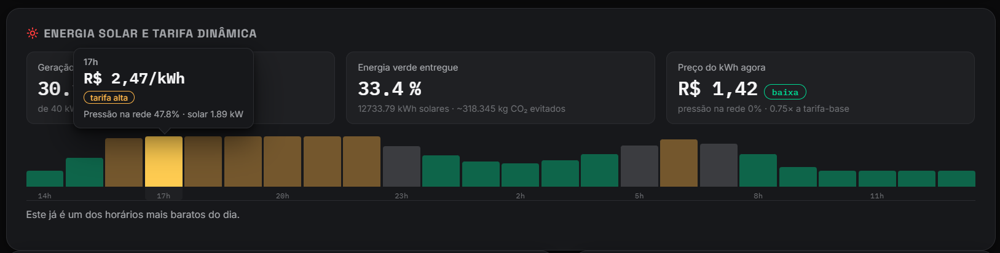
*Visão Geral do dashboard: curva solar do dia, parcela de energia verde e o preço do kWh vigente.*

**3. Hardware via Modbus TCP (simulado).** `simulator/hca_g2_sim.py` simula 12 HCA G2 (um escravo por carregador) com o mapa real de registradores; `HardwareLink` escreve o limite (10029) e o liga/desliga (10060) a cada redistribuição, lê a potência de volta (10015) e tolera falhas de rede (timeout de 0,5 s, cooldown de 5 s, eventos `MODBUS_ERROR`/`MODBUS_RECOVERED`).

**4. IA treinada com histórico.** 60 dias de histórico fictício (picos às 8h e 19h, fim de semana diferente, ≈3.650 sessões) viram dado de treino (`session_demand_samples`); o modelo é re-treinado na subida e sob demanda (`POST /api/predictions/retrain`).

**5. Dashboard.** Gráfico de faturamento por **Dia | Semana | Mês** com variação sobre o período anterior; tooltips visuais em todos os gráficos de barras; Configurações com ícone "i" explicando cada valor, "Faixa de preço" em destaque e um **Modo demonstração** separado.

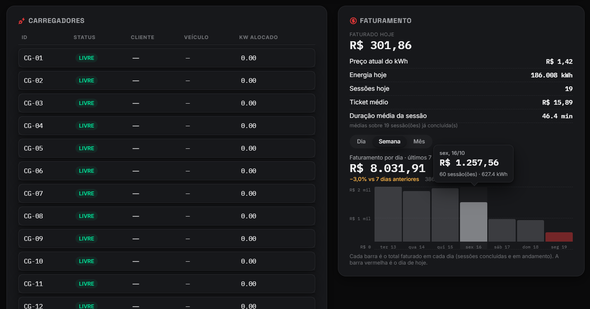
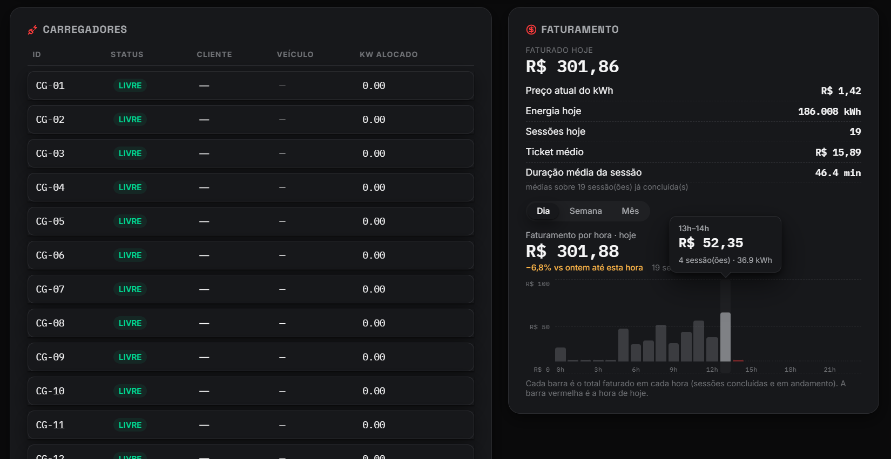
*Gráfico de faturamento com alternância Dia | Semana | Mês e variação sobre o período anterior.*

**6. Segurança e resiliência.** Hash scrypt de senhas, rotas protegidas por login, chave de API entre os serviços, o frontend sobe mesmo com o backend fora do ar, tick de energia à prova de falha.

### 7.1 Como o preço do kWh é calculado

O preço é calculado em `DemandController.pricing_at()` e `core/tariff.py`, em quatro passos:

1. **Pressão da rede (%)** — quanto a rede está apertada, em relação ao limite útil do site (90 kW por padrão):
   `pressão = max(0, demanda − solar) ÷ limite útil × 100`
2. **Multiplicador** — interpolação linear entre o mínimo (`0,75`, pressão ≤ limiar baixo) e o máximo (`1,30`, pressão ≥ limiar alto). Os limiares baixo/alto são calibrados pela IA (P10/P90 da demanda prevista da semana); com a calibração automática desligada valem os manuais (padrão 15% e 55%).
3. **Preço** — `preço = tarifa-base × multiplicador` (base R$ 1,90 → R$ 1,42 a R$ 2,47).
4. **Travamento** — o preço visto na tela de pagamento é gravado na sessão e não muda até o fim da recarga.

O que entra como "demanda" no passo 1 depende de **para qual instante** o preço é calculado:

| Preço calculado para… | Demanda usada na pressão | Onde aparece |
|---|---|---|
| **Agora** (`pricing_now`, `GET /api/tariff`) | **`max(previsão da IA − solar, carga real da rede ÷ limite útil)`** — vale a maior das duas | Preço mostrado ao motorista antes de pagar, preço travado na sessão, painel do operador |
| **Horas futuras** (`pricing_forecast`, `GET /api/tariff/proximas-horas`) | **Só a previsão da IA** (menos o solar daquela hora) | Curva "recarregar às 14h sai mais barato que às 19h", gráfico de preço dos Relatórios |

Ou seja: a previsão da IA **antecipa** o pico e cria o incentivo de horário; a carga real **corrige** o preço de agora quando o site está mais cheio do que o previsto (por exemplo, com 12 carros conectados às 23h a previsão é baixa, mas o preço sobe para perto do teto porque a rede está de fato no limite). A "carga real" é a parte da potência alocada que o solar não cobre (`grid_draw_kw`).

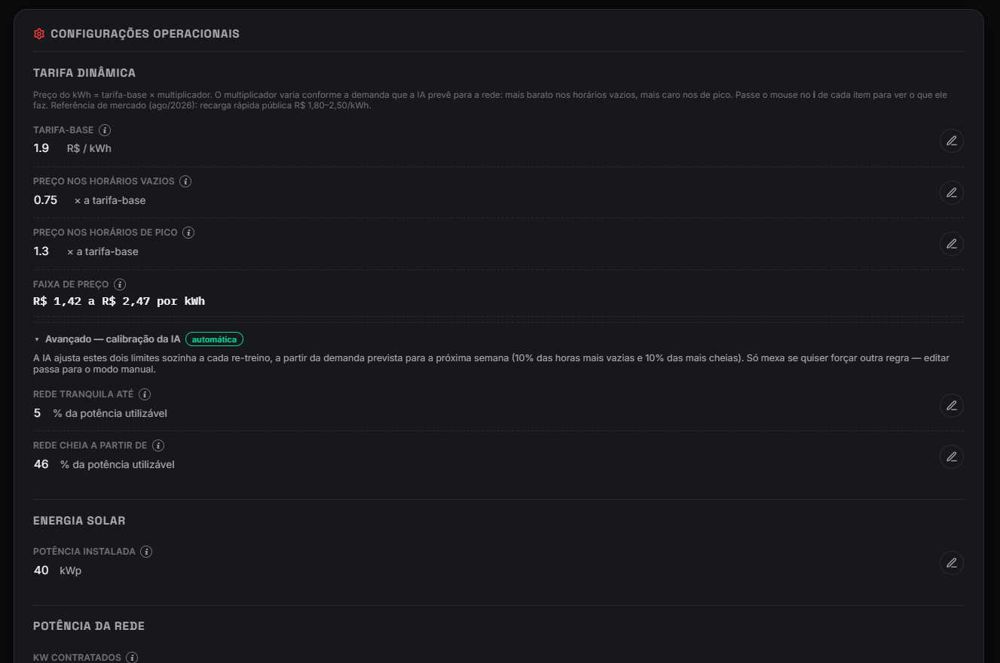
*Tela de Configurações: o operador ajusta a tarifa-base, os multiplicadores, os limiares de pressão (ou deixa a calibração automática ligada) e o solar. São os parâmetros do cálculo acima.*

## 8. Resultados quantitativos

### 8.1 Testes automatizados
**66 testes passando** (48 no backend, 18 no frontend): redistribuição de potência, tarifa e solar, energia verde, simulador Modbus subindo de verdade em porta livre, autenticação, séries de faturamento, calibração da IA e o experimento.

### 8.2 Modelo de IA
| Situação | Amostras | MAE | R² |
|---|---|---|---|
| Só histórico sintético (clone limpo, `./run.sh` na 1ª vez) | 2.160 | **7,8 kW** | **0,67** |
| Re-treinado com os 60 dias de sessões fictícias (após o seed da demo) | 3.600 | **≈ 10 kW** | **≈ 0,53–0,54** |

A métrica **piorou de propósito** após o re-treino: a demanda reconstruída a partir de sessões individuais (chegadas aleatórias) é mais irregular que a curva sintética suave. É o dado mais realista, não um defeito; os dois picos diários continuam capturados. Um modelo linear sobre features de Fourier é totalmente interpretável (os coeficientes são mostrados em `GET /api/predictions/modelo`).

### 8.3 Experimento: com × sem tarifa dinâmica
`backend/scripts/experimento_tarifa.py` — 30 dias × 30 repetições por cenário, semente fixa. **Real:** o preço (mesmo `pricing_at()` do sistema), a previsão (modelo de IA), o solar e o limite (90 kW). **Premissas, não medidas:** a demanda diária é a previsão × ruído, e o comportamento do motorista — uma fração "flexível" aceita deslocar a recarga em até ±3 h, repartindo-se entre as horas mais baratas na proporção da economia. Sem dado de campo sobre essa elasticidade, o script varre a fração flexível (0–40%) em vez de apostar em um valor.

Cenário **congestionado** (demanda × 1,8, o limite de 90 kW passa a apertar):

| Motoristas flexíveis | Pico de demanda | Δ pico | kWh acima do limite/dia | Δ receita |
|---|---|---|---|---|
| 0% (preço fixo R$ 1,90) | 88,3 kW | — | 14,6 | — |
| 10% | 79,7 kW | −9,7% | 5,9 | −5,9% |
| **20%** | **71,4 kW** | **−19,1%** | **2,1 (−86%)** | −7,2% |
| 30% | 73,8 kW | −16,4% | 2,8 | −8,5% |
| 40% | 84,7 kW | −4,1% | 8,5 | −9,8% |

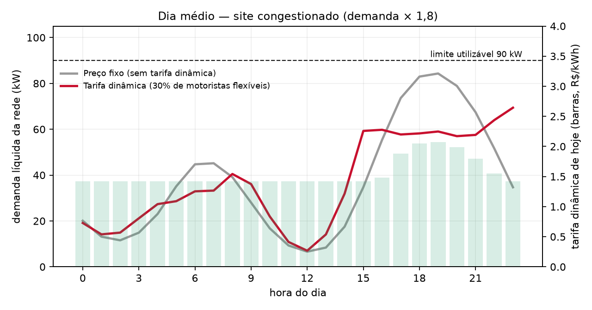
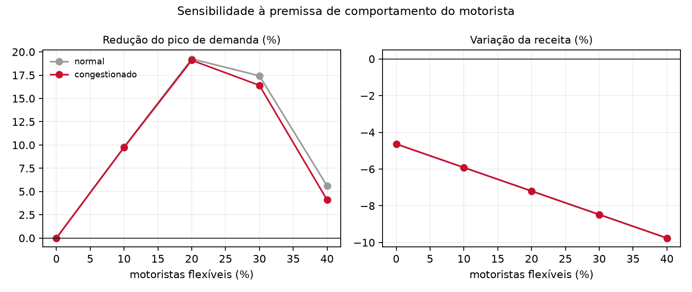

**Leitura honesta:** (a) o ganho é real mas depende da premissa — com ~20% de motoristas flexíveis o pico cai ~19% e quase some o excesso sobre o limite; (b) **não é monotônico**: com muitos flexíveis todos correm para as mesmas horas baratas e criam um pico novo (efeito "manada"), porque o preço das horas futuras vem da *previsão* e não reage ao deslocamento (a carga real só corrige o preço de *agora*, seção 7.1); (c) **a receita cai 5–10%** — o multiplicador médio fica abaixo de 1 (R$ 1,81/kWh de média com 0% de flexíveis) porque a maior parte das horas é folgada. É um trade-off a ser decidido pelo operador (subir a tarifa-base compensa), não um resultado escondido. Detalhes numéricos em `docs/experimento/resultados.json`.
> **Limite do experimento:** o script usa `pricing_at()` sem a carga real, ou seja, só o componente de previsão (seção 7.1). Ele mede o efeito do incentivo de horário, não a correção instantânea do preço de agora pela carga real do site.

### 8.4 Hardware simulado
12 escravos Modbus TCP; escrita em registrador somente-leitura devolve "endereço ilegal" (como o equipamento real); `GET /api/hardware` confirma `in_sync` entre o alocado e o lido de volta; queda do simulador gera `MODBUS_ERROR` sem derrubar o controle.

### 8.5 Evidências do sistema em execução

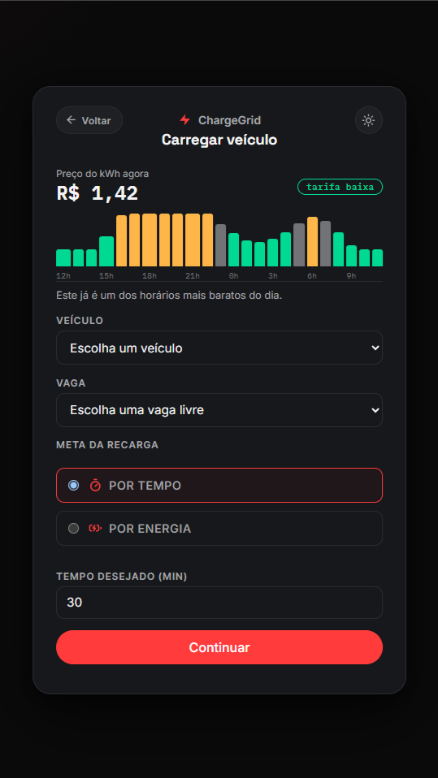
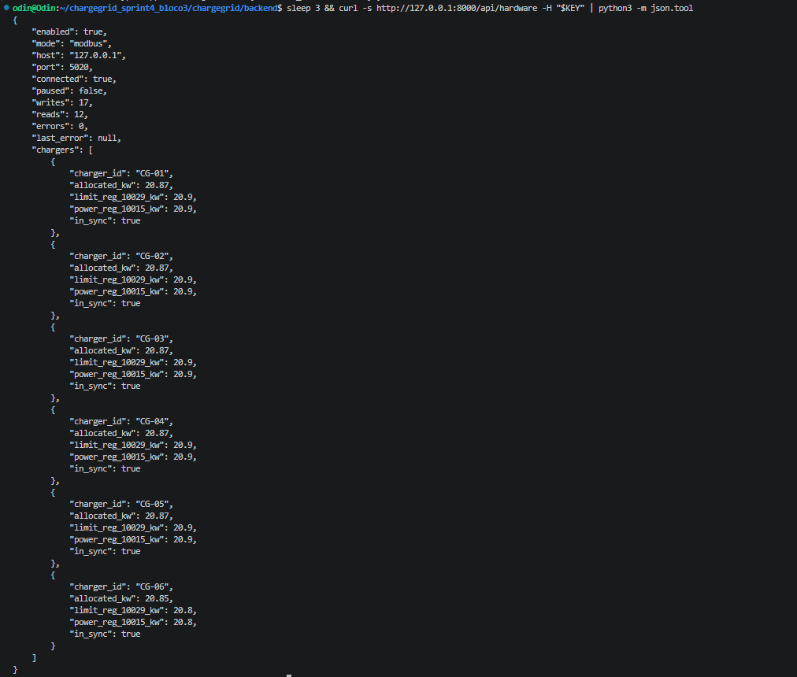
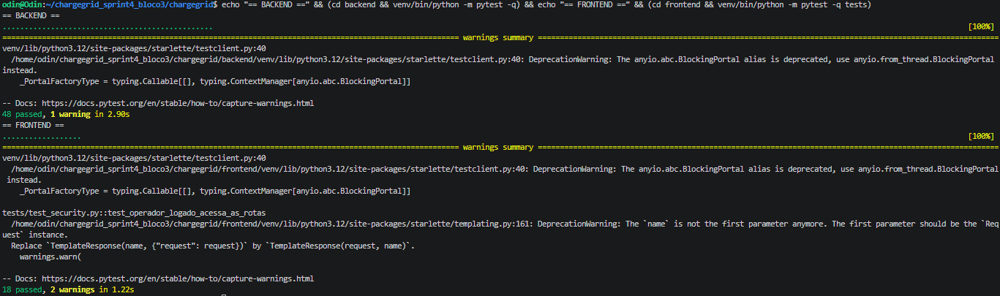

## 9. Resultados qualitativos

- **Para o motorista:** vê o preço do kWh *antes* de pagar, com a curva das próximas horas ("recarregar às 14h sai mais barato que às 19h"); o preço não muda no meio da recarga; o recibo da recarga mostra quanto da energia foi solar (kWh verde).
- **Para o operador:** o gráfico de faturamento por dia/semana/mês e a previsão de demanda estão no mesmo painel; as Configurações explicam cada parâmetro (ícone "i") e **escondem a calibração da IA** em uma área avançada — o operador define só o que é decisão de negócio (tarifa-base, faixa de multiplicadores, kWp, kW contratados).
- **Para quem avalia/demonstra:** um Modo demonstração congela a hora solar sem contaminar as configurações reais; tudo sobe com um comando; dados fictícios são consistentes entre telas.
- **Limitação percebida:** o app ainda não oferece "agendar recarga" — o incentivo de preço só funciona se o motorista puder agir sobre ele (ver roadmap).

## 10. Alinhamento com a GoodWe

| Elemento do projeto | Ligação com a GoodWe |
|---|---|
| Carregador-alvo | **GoodWe HCA G2**, usando o mapa Modbus oficial (protocolo v1.0.15): `10029` Maximum Charging Power (escrita do limite por carregador), `10060` liga/desliga, `10015` Charging Power (leitura de volta), `10017`/`10075` estado do carregador e do veículo |
| Fonte da energia | Registrador `10108` (bit0 rede, bit1 PV, bit2 bateria) é o caminho de produção para o `green_kwh`; hoje o solar é uma curva simulada em `core/solar.py` |
| Solar | `pv_power_kw()` é o ponto de troca: na integração real é substituída pela leitura de potência PV do **inversor GoodWe**; o resto do sistema só enxerga kW |
| Ecossistema | A proposta junta o que a GoodWe vende separadamente — carregador, inversor fotovoltaico e (futuro) bateria — em uma camada de gestão: o solar *amplia o orçamento* dos carregadores e *reduz a tarifa*, a bateria seria o próximo passo natural |
| Protocolo aberto | Modbus (e OCPP no roadmap) evitam lock-in: trocar o simulador pelo equipamento é configuração (`HARDWARE_HOST/PORT`), não código |

**Honestidade sobre o escopo:** nenhuma chamada foi feita a um HCA G2 ou inversor reais — o simulador implementa o mesmo mapa de registradores, e os testes provam o contrato de escrita/leitura, não o comportamento elétrico do equipamento.

## 11. Conexão com os Conteúdos da Disciplina

*(Pensamento Computacional e Automação com Python)*

**Decomposição:** quatro pilares independentes (seção 3), cada um em camadas — hardware (Modbus) / negócio (`DemandController`) / apresentação. A Sprint 4 acrescentou módulos pequenos e testáveis (`tariff`, `solar`, `hardware`, `auth`) em vez de inchar o controlador.

**Abstração:** `_state_snapshot()` entrega só um dicionário; `HardwareLink` esconde o Modbus atrás de "este carregador pode receber X kW"; `RemoteController` esconde de onde vem o dado; `pv_power_kw()` esconde se o solar é curva ou inversor.

**Algoritmos e reconhecimento de padrões:** *water-filling* para repartir a potência (convergência em, no máximo, N iterações); regressão linear sobre **features de Fourier** para reconhecer o padrão de dois picos diários; **percentis (P10/P90)** da previsão para calibrar os limiares da tarifa; interpolação linear do multiplicador; simulação de Monte Carlo no experimento.

**Automação:** `energy_tick_loop` (`asyncio`, acumula energia a cada segundo), re-treino automático da IA a partir do histórico, escrita automática dos limites no hardware a cada redistribuição, calibração automática da tarifa, scripts de demo e de experimento reprodutíveis (semente fixa).

**Python aplicado:** `dataclasses`, `asyncio`, `Pydantic`, `FastAPI`, `scikit-learn`, `pymodbus`, `httpx`, `hashlib.scrypt` (stdlib), `pytest` (66 testes), `matplotlib` (gráficos do experimento) e `argparse` nos scripts.

## 12. Avaliação crítica: sustentabilidade e inovação

### Sustentabilidade — o que realmente entregamos (e o que não)
- **Redução de pico é o ganho principal, não o CO₂.** A matriz elétrica brasileira já é muito renovável; usamos 0,025 kgCO₂/kWh (ordem de grandeza dos fatores do MCTI para o SIN em 2025), então o "CO₂ evitado" do solar é pequeno e o apresentamos como indicador secundário. O benefício concreto é **evitar infraestrutura e multa**: no cenário congestionado, ~20% de motoristas flexíveis cortam o pico em ~19% e o excesso sobre o limite em ~86% (seção 8.3) — sem pedir mais demanda contratada.
- **O solar é simulado.** Curva senoidal determinística, sem nuvens e sem bateria. Os números de kWh verde mostram o *mecanismo*, não a geração real de um sítio; nuvens e sazonalidade reduziriam o ganho em dias ruins.
- **Efeito rebote.** O preço das horas futuras vem da previsão e não reage ao deslocamento (a carga real só corrige o preço de *agora*, seção 7.1): com muitos motoristas flexíveis, o pico apenas muda de hora. A solução (preço em malha fechada, ou limites de potência por horário) está no roadmap.
- **Equidade.** Preço dinâmico penaliza quem não pode escolher o horário (turno fixo, emergência). O limite máximo de +30% sobre a base e o preço travado na sessão reduzem o risco, mas não o eliminam.
- **Receita × sustentabilidade.** A receita cai 5–10% no experimento. Um projeto sustentável precisa ser viável: por isso a tarifa-base é do operador, e o experimento mostra o custo de cada nível de incentivo.
- **Ciclo de vida:** protocolos abertos (Modbus/OCPP) evitam o descarte de hardware por incompatibilidade de plataforma; não medimos esse efeito.

### Inovação — onde está e onde não está
- **Não é novo isoladamente:** tarifa por horário, previsão de demanda e balanceamento de carga existem em plataformas de gestão (CSMS) comerciais.
- **O que é diferente aqui** é a **integração fechada**: previsão da IA → pressão líquida (descontando o solar) → preço travado por sessão → orçamento de potência (rede + solar) → registrador do hardware, com **calibração automática dos limiares pela própria previsão** e um modelo linear cujos coeficientes qualquer pessoa consegue auditar.

## 13. Riscos e Limitações Reconhecidas

- **Dados fictícios.** Clientes, 60 dias de histórico e a curva solar são sintéticos; as métricas da IA e o experimento descrevem o *método*, não um site real.
- **Elasticidade do motorista é premissa** (seção 8.3); o resultado não é monotônico e a receita cai.
- **Modelo linear simples** (R² 0,53–0,67): captura dois picos diários e fim de semana, mas não eventos, feriados, clima nem a variabilidade do solar.
- **Hardware só simulado:** Modbus validado contra o simulador, não contra um HCA G2; o ESP32 físico continua representado por `simulate_esp32.py`.
- **Segurança é de protótipo:** hash scrypt e chave de API existem, mas o CORS do backend é `*`, as sessões de login e as contas ficam em memória (reiniciar zera), não há limite de tentativas de login e a senha da conta demo é fixa no código por ser de demonstração. Nenhuma camada de segurança OCPP foi tratada.
- **Dependência de conectividade:** Modbus e pagamento dependem de rede; falha de rede vira evento e o controle segue em memória, mas a cobrança no modo `mercadopago` depende do Mercado Pago (o sandbox já oscilou durante o desenvolvimento — por isso o modo `mock`).
- **Janela de corrida teórica** entre dois clientes escolhendo a mesma vaga antes do pagamento confirmar (sem reserva de vaga).

## 14. Histórico das Sprints 2 e 3 e Roadmap

### Sprint 2 — Prova de conceito do controle de demanda

A Sprint 2 implementou o pilar de **Controle de Demanda** como código funcional em Python puro (sem dependências externas), rodando em terminal, com arquitetura já desacoplada (lógica / apresentação / hardware) para facilitar a evolução futura.

**Cenário simulado:** site "Shopping Paulista — Estacionamento", 100 kW contratados, limite de uso de 90% por padrão (90 kW úteis; ajustável de 50% a 95% em Configurações), 12 carregadores GoodWe HCA G2 de 22 kW cada (demanda potencial total: 264 kW — 2,6× a demanda contratada). Na Sprint 2 o limite de uso era fixo em 95%; a partir da Sprint 3 ele é configurável, com padrão de 90%.

**Comportamento observado, em 3 fases:**

- **Fase 1 — Chegada gradual** (6 carros): orçamento folgado, cada carregador recebe os 22 kW completos.
- **Fase 2 — Congestionamento** (12/12 carros): a demanda potencial (264 kW) ultrapassa em muito os 90 kW úteis. O sistema reduz cada carregador para 7,5 kW (90 ÷ 12; com o limite fixo de 95% da Sprint 2, eram ~7,92 kW) — todos continuam carregando, limite respeitado, zero multas.
- **Fase 3 — Alívio** (carros desconectando): a potência por carregador sobe automaticamente a cada saída, até que restem 4 carros, que já recebem os 22 kW completos — agora o gargalo é o hardware, não mais o orçamento.

Esse comportamento (algoritmo de "cascata de sobras" / *water-filling*) permanece **idêntico** na Sprint 3 — a lógica do `_redistribute_power()` não foi alterada; o `demand_controller.py` apenas ganhou métodos e campos ao redor dela: `tick_energy` (energia acumulada em tempo real), `update_settings` (kW contratados e limite de uso ajustáveis em tempo de execução), `import_completed_sessions` (importação de histórico) e o campo `ended_at` na sessão (seção 8.1).

### Sprint 3 — Prototipagem funcional e integração
Backend exposto como API REST, ESP32 simulado via HTTP, frontend religado ao backend real por `RemoteController`, IA conectada de ponta a ponta, parâmetros do site editáveis em runtime e roteiro de demonstração ao vivo. As justificativas técnicas das escolhas:

#### Justificativa técnica das escolhas

**Por que dois processos HTTP (padrão BFF) em vez de um único backend monolítico:** o frontend já existia como protótipo funcional rico (design system, WebSocket, Mercado Pago Pix real) construído por outro integrante, mas com lógica de negócio duplicada localmente. Reescrever esse frontend do zero para falar diretamente com o backend teria descartado semanas de trabalho de UI/UX e de integração de pagamento. A solução foi criar `RemoteController` — uma classe que imita a interface do `DemandController` original, mas por dentro faz chamadas HTTP — reduzindo a migração a poucas dezenas de linhas alteradas (adicionar `await` nas chamadas que viraram requisições de rede) em vez de reescrever ~40 rotas.

**Por que o ESP32 se comunica por HTTP simples (evento + polling) em vez de MQTT ou WebSocket:** o hardware ainda não está em mãos, e o objetivo da Sprint 3 é demonstrar a integração, não otimizar protocolo de campo. HTTP é suportado nativamente pela biblioteca padrão do Arduino/ESP32 (`HTTPClient`), sem bibliotecas adicionais. O padrão escolhido — evento (`connect`/`disconnect`, como um `StartTransaction`/`StopTransaction` do OCPP) mais polling da potência alocada — é diretamente reaproveitável como conceito quando o projeto migrar para OCPP real na Sprint 4.

**Por que regressão linear (com features cíclicas) em vez de LSTM/XGBoost, mencionados como ideais na Sprint 1:** com poucas semanas de operação, o histórico real disponível é mínimo — modelos mais complexos (LSTM, redes neurais) exigem ordens de magnitude mais dados para não sobreajustar, e são caixas-pretas difíceis de explicar em uma banca de 1º ano. Uma regressão linear sobre features de Fourier (seno/cosseno) é totalmente interpretável (dá para mostrar cada coeficiente) e já captura o padrão de dois picos com R² de 0,67. LSTM/XGBoost continuam no roadmap (seção 13) para quando houver meses de dado real acumulado.

**Por que o `tick_energy()` roda no backend, não no ESP32 ou no frontend:** a energia consumida (kWh) é calculada como potência × tempo. Se o cálculo dependesse do ESP32 avisar o consumo periodicamente, ficaria vulnerável a perda de conexão do hardware. Calcular no backend, a partir da potência já alocada pelo próprio algoritmo de redistribuição, garante que o dado é consistente mesmo se o dispositivo físico falhar — e funciona identicamente para os 11 carregadores que ainda são simulados em software.

### Roadmap

```
Sprint 1 ✅  Proposta arquitetural, pilares, fundamentos de sustentabilidade
Sprint 2 ✅  Prova de conceito do Controle de Demanda + mapa Modbus do HCA G2
Sprint 3 ✅  API REST, ESP32 simulado, frontend integrado, IA ponta a ponta
Sprint 4 ✅  Tarifa dinâmica movida por IA + solar/kWh verde + Modbus TCP simulado
             + segurança + experimento com/sem tarifa dinâmica
```


## 15. Referências

- ABVE — Associação Brasileira de Veículos Elétricos. Dados de mercado 2025. https://abve.org.br/abve-data/
- AutoIndústria. A nova geografia da recarga elétrica no Brasil. Fev. 2026. https://www.autoindustria.com.br/2026/02/24/a-nova-geografia-da-recarga-eletrica-no-brasil/
- Cenário Energia. Infraestrutura de recarga rápida cresce 59% em 6 meses no Brasil. Set. 2025. https://cenarioenergia.com.br/2025/09/12/infraestrutura-de-recarga-rapida-para-veiculos-eletricos-cresce-59-em-seis-meses-no-brasil/
- GoodWe Technologies. HCA Series EV Charger. https://en.goodwe.com/hca-series
- GoodWe Technologies. GoodWe is Accelerating the Global Transition Toward a New Power System. Nov. 2025.
- GoodWe Technologies. Mapa MODBUS HCA G2 — Protocolo v1.0.15, 2025.
- Open Charge Alliance (OCA). Open Charge Point Protocol — OCPP. https://openchargealliance.org/protocols/open-charge-point-protocol/
- Monta. Open charge point protocol (OCPP): Definition, versions, benefits. 2026. https://monta.com/en/blog/ocpp/
- Amina Charging. A Complete Guide to OCPP for EV Charging. Dez. 2025. https://aminacharging.com/articles/complete-guide-ocpp-ev-charging/
- Driivz. How AI is Transforming EV Charging Networks Globally. Dez. 2024. https://driivz.com/blog/ai-transformative-role-in-ev-charging-networks/
- Kyriakopoulos, I.; Theodoridis, Y. Electric Vehicle Charging Load Forecasting. ArXiv, Abr. 2026. https://arxiv.org/pdf/2512.17257
- MDPI Energies. Machine Learning-Based EV Charging Demand Forecasting. Set. 2025. https://www.mdpi.com/1996-1073/18/17/4779
- MDPI Engineering Proceedings. Dynamic Pricing for Load Balancing in EV Charging Stations. Out. 2025. https://www.mdpi.com/2673-4591/112/1/11
- ANEEL. Resolução Normativa nº 1.000, de 7 de dezembro de 2021. https://www2.aneel.gov.br/cedoc/ren20211000.html
- Voltbras. Legislação Brasileira sobre eletropostos. Fev. 2026.
- Gazeta do Povo. Rede de recarga cresce para acompanhar alta dos carros elétricos. Mar. 2026.
- OpenOCPP — Open-source embedded software for EV chargers. https://openocpp.com/
- pymodbus — Python Modbus stack. https://github.com/pymodbus-dev/pymodbus
- scikit-learn — Machine Learning in Python. https://scikit-learn.org/
- FastAPI. https://fastapi.tiangolo.com/
- MCTI — Fatores de emissão de CO₂ pela geração de energia elétrica no SIN (série mensal 2025), base do fator de 0,025 kgCO₂/kWh usado em `core/solar.py`.
- Referência de preços de recarga pública (R$ 1,80–2,50/kWh, DC rápido) e de energia residencial (~R$ 0,85/kWh): levantamento de ago/2026 feito pela equipe (VRUM/Dok), usado para calibrar a tarifa-base.
