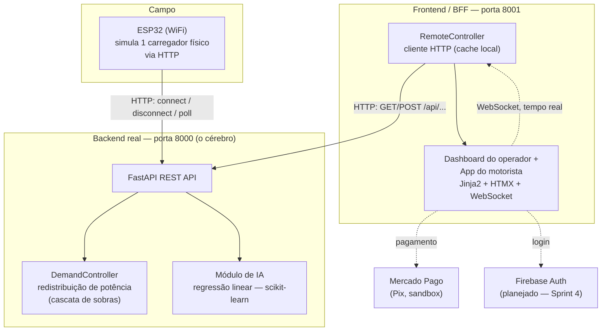
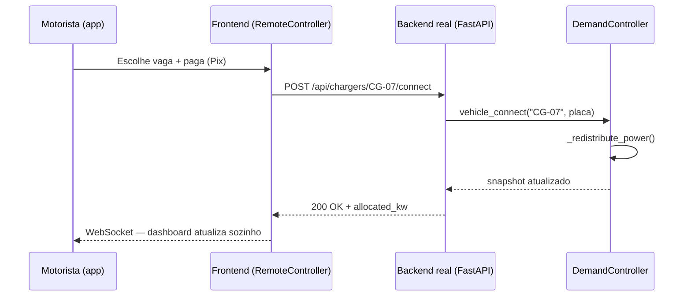

# ChargeGrid Intelligence
### Sistema Integrado de Gestão Comercial de Eletropostos

**GoodWe EV Challenge 2026 — FIAP | 1CCR — Equipe 04**

## Integrantes

| Nome | RM |
|------|----|
| Gabriela Angel Silva | 570808 |
| Izabelly Menezes | 570673 |
| Marcos Paulo Sampaio | 573987 |
| Otávio Santos | 570225 |
| Tiago Muhlmann | 569569 |
| Wesley Marques | 573915 |

**Curso:** Ciência da Computação — 1º Ano | **Instituição:** FIAP

---

## Sumário

1. [Contexto e Motivação](#1-contexto-e-motivação)
2. [Problema Central](#2-problema-central)
3. [Solução Proposta — Os Quatro Pilares](#3-solução-proposta--os-quatro-pilares)
4. [Arquitetura do Sistema (Sprint 3)](#4-arquitetura-do-sistema-sprint-3)
5. [Estrutura do Repositório](#5-estrutura-do-repositório)
6. [Como Executar](#6-como-executar)
7. [Sprint 2 — Prova de Conceito do Controle de Demanda](#7-sprint-2--prova-de-conceito-do-controle-de-demanda)
8. [Sprint 3 — Prototipagem Funcional e Integração](#8-sprint-3--prototipagem-funcional-e-integração)
9. [Integração com Hardware Real (HCA G2)](#9-integração-com-hardware-real-hca-g2)
10. [Conexão com os Conteúdos da Disciplina](#10-conexão-com-os-conteúdos-da-disciplina)
11. [Princípios de Energias Renováveis e Sustentabilidade](#11-princípios-de-energias-renováveis-e-sustentabilidade)
12. [Riscos e Limitações Reconhecidas](#12-riscos-e-limitações-reconhecidas)
13. [Evolução do Projeto — Roadmap](#13-evolução-do-projeto--roadmap)
14. [Entregáveis desta Sprint](#14-entregáveis-desta-sprint)
15. [Referências](#15-referências)

---

## 1. Contexto e Motivação

O Brasil vive um momento de inflexão no setor de mobilidade elétrica. Em 2025 o mercado de veículos elétricos e híbridos plug-in registrou **223.912 unidades vendidas** (+26% em relação a 2024), e os dois primeiros meses de 2026 já somaram **48.591 emplacamentos** — 90% a mais que no mesmo bimestre de 2025. O país acumula mais de 350 mil veículos plug-in em circulação e **16.880 eletropostos** públicos e semipúblicos, expansão de ~290% desde 2023.

Esse crescimento acelerado expõe um gargalo estrutural: a infraestrutura de recarga comercial (shoppings, supermercados, postos, estacionamentos) carece de **inteligência operacional**. O hardware evoluiu; os sistemas de gestão de potência, faturamento e monitoramento em tempo real não acompanharam. Cada sessão de recarga é um evento rico em dados que raramente é capturado, analisado e transformado em valor.

Nesse cenário, a parceria FIAP × GoodWe originou o **EV Challenge 2026**, desafio acadêmico que propõe aos alunos do 1º ano o desenvolvimento de soluções reais para gestão inteligente de eletropostos comerciais.

## 2. Problema Central

A ausência de mecanismos integrados capazes de orquestrar potência, registrar ciclos de recarga, faturar automaticamente e se comunicar com sistemas externos se traduz em cinco disfunções, cada uma endereçada por um ou mais dos quatro pilares do projeto:

| Problema | Conexão com os pilares |
|---|---|
| **Sobrecarga em horários de pico** — usuários carregam predominantemente à tarde/noite, sobrepondo picos residenciais e comerciais | Controle de Demanda (gestão em tempo real) + IA (previsão antecipada) + Tarifação (preço dinâmico redistribui a demanda) |
| **Falta de padronização** — cada fabricante usa protocolo proprietário; trocar de plataforma custa 3–5× mais | Protocolos Abertos (OCPP/MODBUS como requisito arquitetural) |
| **Complexidade de cobrança** — tarifa pode variar durante a própria sessão; ~40% dos usuários já pagaram valor diferente do esperado | Tarifação e Pagamento |
| **Experiência do usuário** — falta de informação antecipada sobre preço/disponibilidade, ausência de feedback em tempo real | Todos os quatro pilares |
| **Ineficiência energética** — capacidade instalada subutilizada fora do pico, picos desnecessários por falta de gestão | IA (planejamento antecipado) + Controle de Demanda (correção em tempo real) |

Um estabelecimento com 20 carregadores de 22 kW pode demandar até 440 kW simultâneos no pior caso — muito acima do tipicamente contratado. Sem gestão ativa, isso significa multas por ultrapassagem de demanda ou racionamento arbitrário entre usuários.

### Objetivo do projeto

Projetar e prototipar um sistema de orquestração capaz de: **(a)** controlar dinamicamente a potência por ponto de carga respeitando a demanda contratada; **(b)** integrar equipamentos de fabricantes diferentes via OCPP/MODBUS; **(c)** automatizar o faturamento das sessões; **(d)** aplicar IA para prever picos e otimizar a alocação de potência.

## 3. Solução Proposta — Os Quatro Pilares

```
┌─────────────────────────────────────────────────────────┐
│                  ChargeGrid Intelligence                │
├──────────────┬──────────────┬──────────────┬────────────┤
│  Controle de │  Protocolos  │  Tarifação e │     IA     │
│   Demanda    │    Abertos   │  Pagamento   │  Preditiva │
│              │  OCPP/MODBUS │              │            │
└──────────────┴──────────────┴──────────────┴────────────┘
```

**Controle Dinâmico de Potência** — define um orçamento de potência para o site (ex: 100 kW) e redistribui automaticamente entre carregadores ativos a cada conexão/desconexão, sem jamais ultrapassar o limite contratado.

**Protocolos Abertos (OCPP + MODBUS)** — comunica-se com o hardware via padrões abertos em vez de SDKs proprietários. O mercado de plataformas OCPP movimentou US$ 1,47 bi em 2024 (+22,8% a.a.); operadores presos a sistemas proprietários enfrentam custos de migração 3–5× maiores.

**Tarifação e Pagamento** — cobrança automática por kWh consumido, com tarifa que varia por horário/condição da rede. Amparada pela Resolução ANEEL nº 1.000/2021, que permite preços livremente negociados na recarga comercial.

**Inteligência Artificial** — três funções: **interpretação** (traduzir eventos OCPP/MODBUS em eventos semânticos), **preditividade** (antecipar picos de demanda) e **conversão** (insights em linguagem natural para o operador).

## 4. Arquitetura do Sistema (Sprint 3)

A Sprint 3 trouxe uma mudança estrutural importante em relação à Sprint 2: o sistema deixou de ser um processo único e passou a ser **dois processos HTTP independentes**, seguindo o padrão *Backend for Frontend* (BFF) — decisão detalhada na seção 8.3.



### Fluxo de um evento de conexão



### Por que a arquitetura é desacoplada

O `DemandController` expõe apenas `_state_snapshot()` — um dicionário Python puro, sem qualquer conhecimento de HTTP, terminal ou web. Isso permitiu, entre a Sprint 2 e a Sprint 3, trocar toda a camada de apresentação (de terminal para API REST + dashboard web) **sem alterar uma linha da lógica de negócio**. Na Sprint 3, essa mesma desacoplagem permitiu que o frontend (construído por outro membro da equipe, originalmente como um segundo `DemandController` local) fosse religado ao backend real via `RemoteController` — uma classe que imita a interface antiga, mas por dentro faz requisições HTTP — sem reescrever as ~40 rotas que já existiam.

## 5. Estrutura do Repositório

```
chargegrid/
├── run.sh                    ← sobe o projeto inteiro com 1 comando
│
├── backend/                  ← o "cérebro": FastAPI + algoritmo de redistribuição
│   │                            + IA. É AQUI que o ESP32 conecta (porta 8000).
│   ├── main.py
│   ├── requirements.txt
│   ├── core/
│   │   ├── demand_controller.py   # DemandController, Charger, ChargingSession
│   │   ├── modbus_map.py          # mapa de registradores do GoodWe HCA G2
│   │   └── state.py               # instância única do controller (12 carregadores)
│   ├── routers/
│   │   ├── chargers.py            # /api/chargers, /api/sessions (+ /import), /api/events
│   │   ├── predictions.py         # /api/predictions/proximas-horas
│   │   └── settings.py            # /api/settings (kW contratados + limite de uso, editáveis em runtime)
│   ├── ai/                        # Pilar de IA (regressão de demanda)
│   │   ├── generate_history.py    # gera histórico sintético (90 dias)
│   │   ├── features.py            # engenharia de features cíclicas
│   │   ├── train_model.py         # treina e salva o modelo
│   │   └── predictor.py           # serve previsões
│   └── simulate_esp32.py          # simula o hardware via HTTP (sem placa física)
│
└── frontend/                 ← dashboard do operador + app do motorista
    ├── requirements.txt
    ├── backend/                   # servidor Jinja2/HTMX/WebSocket (porta 8001)
    │   ├── main.py
    │   ├── remote_controller.py   # cliente HTTP do backend real
    │   ├── payments.py            # integração Mercado Pago (Pix) + modo mock
    │   ├── client_store.py        # contas de motorista (em memória)
    │   ├── company_store.py       # contas de empresa/operador (em memória)
    │   ├── demo_seed.py           # 12 clientes fictícios + histórico inicial da demo
    │   ├── chatbot.py             # assistente baseado em regras
    │   ├── templates/             # páginas Jinja2 (dashboard + app do motorista)
    │   └── static/                # CSS e JS
    └── scripts/
        ├── seed_demo.py           # ocupa vagas com clientes fictícios cadastrados (--listar mostra logins)
        ├── demo_scenario.py       # roteiro em 3 fases, com tempo (demo ao vivo)
        └── demo_api.py            # cliente HTTP compartilhado pelos dois
```

## 6. Como Executar

Pré-requisito: Python 3.11+.

```bash
./run.sh
```

Na primeira vez, isso cria os dois `venv`, instala as dependências, gera 90 dias de histórico sintético e treina o modelo de IA, e sobe os dois servidores. Nas próximas vezes, pula direto para subir os servidores.

- **http://127.0.0.1:8001** — página de entrada: "Sou cliente" (app do motorista) ou "Sou empresa" (dashboard do operador)
- **http://127.0.0.1:8000/docs** — API do backend real (Swagger interativo, onde o ESP32 conecta)

`Ctrl+C` encerra os dois. Com o projeto no ar, em outro terminal:

```bash
# Simula o ESP32 físico via HTTP (sem precisar da placa)
cd backend && venv/bin/python simulate_esp32.py

# Roteiro de demo em 3 fases (chegada gradual → pico → alívio), ao vivo no dashboard.
# Quem carrega são 12 CLIENTES FICTÍCIOS JÁ CADASTRADOS (login com CPF + senha demo123)
cd frontend && venv/bin/python scripts/demo_scenario.py

# Ocupa vagas instantaneamente com clientes cadastrados (útil pra testar rápido)
cd frontend && venv/bin/python scripts/seed_demo.py

# Lista os clientes fictícios e como logar como um deles
cd frontend && venv/bin/python scripts/seed_demo.py --listar
```

### Pagamento: configuração do `.env`

O fluxo do app do motorista termina em um pagamento. Por padrão (`PAYMENT_MODE=mercadopago`), o sistema gera um Pix real no sandbox do Mercado Pago, o que exige credenciais. O arquivo `.env` guarda segredos e **não é versionado** (está no `.gitignore`), então quem clonar o repositório precisa criá-lo em `frontend/.env`. Sem ele, o passo de pagamento falha.

Para rodar sem credenciais, use o modo de contingência `mock`, em que todo pagamento é aprovado na hora, sem chamar nenhuma API externa:

```bash
# frontend/.env
PAYMENT_MODE=mock
```

Para o Pix real em sandbox:

```bash
# frontend/.env
PAYMENT_MODE=mercadopago
MP_ACCESS_TOKEN=<access token de teste do Mercado Pago>
MP_PUBLIC_KEY=<chave pública de teste do Mercado Pago>
```

O `.env` é lido na inicialização: depois de alterá-lo, reinicie o `./run.sh`.

### Acessos de demonstração

Ao subir, o frontend cadastra sozinho uma empresa de demonstração e **12 clientes fictícios**, já com **18 recargas anteriores** no histórico — então Clientes, Histórico e Faturamento abrem com dados.

| Perfil | Onde entrar | Credenciais |
|---|---|---|
| Empresa (operador) | `/empresa/login` | `contato@chargegrid.com` / `demo123` |
| Cliente (motorista) | `/cliente/login` | CPF + senha `demo123` — ex.: Mariana Costa, CPF `39053344705` |

Os CPFs dos 12 clientes aparecem na tela **Clientes** do dashboard e em `seed_demo.py --listar`; qualquer pessoa também pode criar uma conta nova em `/cliente/cadastro`. Nomes, CPFs (válidos só no dígito verificador) e e-mails são inventados. A variável de ambiente `DEMO_MODE=0` desliga os clientes fictícios, o histórico inicial e as rotas de demo.

### O que experimentar

- **Fluxo do motorista:** entre como cliente, escolha "Carregar veículo", uma vaga livre e a meta da recarga (tempo ou energia), confira a estimativa e pague. A recarga começa de verdade no backend real e dá para acompanhá-la (ou encerrá-la) pelo app.
- **Tempo real:** com o dashboard da empresa aberto em outra aba, a vaga aparece ocupada sozinha (WebSocket, sem recarregar). Clicar num carregador mostra os detalhes e permite forçar o encerramento como ação operacional.
- **Controle de demanda:** em Configurações, altere os kW contratados ou o limite de uso antes da redução de potência (padrão 90%, máximo 95%); a potência das sessões em andamento é redistribuída na hora.
- **Assistente IA** no dashboard: "quantos livres?", "faturamento de hoje", "status do CG-03".

## 7. Sprint 2 — Prova de Conceito do Controle de Demanda

A Sprint 2 implementou o pilar de **Controle de Demanda** como código funcional em Python puro (sem dependências externas), rodando em terminal, com arquitetura já desacoplada (lógica / apresentação / hardware) para facilitar a evolução futura.

**Cenário simulado:** site "Shopping Paulista — Estacionamento", 100 kW contratados, limite de uso de 90% por padrão (90 kW úteis; ajustável de 50% a 95% em Configurações), 12 carregadores GoodWe HCA G2 de 22 kW cada (demanda potencial total: 264 kW — 2,6× a demanda contratada). Na Sprint 2 o limite de uso era fixo em 95%; a partir da Sprint 3 ele é configurável, com padrão de 90%.

**Comportamento observado, em 3 fases:**

- **Fase 1 — Chegada gradual** (6 carros): orçamento folgado, cada carregador recebe os 22 kW completos.
- **Fase 2 — Congestionamento** (12/12 carros): a demanda potencial (264 kW) ultrapassa em muito os 90 kW úteis. O sistema reduz cada carregador para 7,5 kW (90 ÷ 12; com o limite fixo de 95% da Sprint 2, eram ~7,92 kW) — todos continuam carregando, limite respeitado, zero multas.
- **Fase 3 — Alívio** (carros desconectando): a potência por carregador sobe automaticamente a cada saída, até que restem 4 carros, que já recebem os 22 kW completos — agora o gargalo é o hardware, não mais o orçamento.

Esse comportamento (algoritmo de "cascata de sobras" / *water-filling*) permanece **idêntico** na Sprint 3 — a lógica do `_redistribute_power()` não foi alterada; o `demand_controller.py` apenas ganhou métodos e campos ao redor dela: `tick_energy` (energia acumulada em tempo real), `update_settings` (kW contratados e limite de uso ajustáveis em tempo de execução), `import_completed_sessions` (importação de histórico) e o campo `ended_at` na sessão (seção 8.1).

## 8. Sprint 3 — Prototipagem Funcional e Integração

### 8.1 O que foi construído

- **Backend real exposto via API REST** (antes só rodava em terminal): `GET/POST /api/chargers/*`, `GET /api/sessions` (+ `POST /api/sessions/import`), `GET /api/events`, `GET /api/predictions/proximas-horas` e `GET/PUT /api/settings`. Ganhou também `tick_energy()` — um método que acumula energia em todas as sessões ativas a cada segundo, chamado por um loop assíncrono em `main.py`, para que o kWh consumido suba em tempo real no dashboard (antes só era calculado no instante da desconexão).
- **ESP32 simulado via HTTP**: `simulate_esp32.py` reproduz exatamente as chamadas que o firmware C++ real fará (`connect` → `poll` a cada poucos segundos → `disconnect`), servindo de roteiro direto para quando a placa física estiver disponível.
- **Pilar de IA conectado de ponta a ponta**: modelo de regressão linear treinado sobre histórico (sintético + capaz de incorporar sessões reais conforme se acumulam), servido via API, consumido pelo dashboard como gráfico de barras colorido por risco de ultrapassar o limite útil (ver 8.2 para os números).
- **Integração do frontend com o backend real**: o dashboard do operador e o app do motorista — que tinham sido desenvolvidos por outro integrante como um protótipo autocontido, com seu próprio `DemandController` local — foram religados ao backend real via `RemoteController` (detalhes em 8.3), preservando toda a interface já construída (design system, WebSocket, integração real com Mercado Pago Pix, assistente de chat).
- **Parâmetros do site ajustáveis em tempo de execução**: os kW contratados e o limite de uso (percentual da demanda contratada que pode ser usado antes de o controlador reduzir a potência dos carregadores; padrão 90%, máximo 95%) são editáveis pelo dashboard via `PUT /api/settings`, e a potência das sessões em andamento é redistribuída na hora.
- **Roteiro de demonstração ao vivo**: `demo_scenario.py` dirige o sistema real pelas 3 fases da Sprint 2 (chegada gradual → congestionamento → alívio), com o dashboard reagindo em tempo real via WebSocket — usado tanto para testes quanto para a própria gravação do vídeo desta sprint. Quem carrega são **12 clientes fictícios já cadastrados** (com login, veículos salvos e histórico), então cada recarga passa pelo mesmo fluxo do app do motorista — só o pagamento é pulado.

### 8.2 Resultados e dados funcionais

**Redistribuição de potência** (mesmo algoritmo da Sprint 2, agora testado via HTTP real): com 2 carregadores ativos e orçamento de 90 kW úteis (padrão atual), cada um recebeu os 22 kW completos (44 kW alocados no total — orçamento com folga). Com o grid cheio (12/12), cada carregador recebe 7,5 kW (90 ÷ 12); com o limite fixo de 95% da época da Sprint 2, eram os ~7,92 kW descritos na seção 7.

**Modelo de IA (regressão linear, scikit-learn):**
- Dataset: 90 dias de histórico sintético (2.160 amostras horárias), gerado a partir de uma curva de dois picos diários (manhã ~8h, noite ~19h) mais ruído — necessário porque o histórico real do site ainda é recente.
- Features: seno/cosseno cíclicos da hora (períodos de 24h **e** 12h, para capturar os dois picos com um modelo ainda linear) e do dia da semana, mais indicador de fim de semana.
- **MAE: 7,97 kW | R²: 0,671** — captura corretamente o formato de dois picos (verificado: previsão de 51,35 kW às 19h, o pico real do dataset; ~8–10 kW na madrugada, o vale real). Um R² de 0,67 é um resultado honesto para um modelo linear simples — não perfeito de propósito, o que é discutido na seção 10.
- Endpoint testado (`GET /api/predictions/proximas-horas`) devolve a previsão hora a hora já comparada ao limite útil (`usable_limit_kw`, campo `pct_of_limit`), consumida pelo dashboard sem nenhum cálculo adicional no frontend.

**Fluxo completo do usuário, testado de ponta a ponta** (cadastro → login → escolha de vaga → pagamento Pix mock → recarga → encerramento):
1. Pagamento confirmado dispara `POST /api/chargers/CG-01/connect` no backend real
2. Backend real confirma `status: OCUPADO`, `vehicle_id` preenchido
3. Dashboard do operador reflete a mudança (via WebSocket, sem reload)
4. Encerramento pelo app do motorista dispara `disconnect`; backend real volta a `LIVRE`
5. Sessão concluída aparece em `GET /api/sessions` e na tela de histórico do dashboard

**Roteiro de demo** (`demo_scenario.py`, testado a 20× velocidade): 12 conexões + 12 desconexões, todas confirmadas `OK`; estado final no backend real conferido como `active_sessions: 0`, `total_allocated_kw: 0.0`.

### 8.3 Justificativa técnica das escolhas desta sprint

**Por que dois processos HTTP (padrão BFF) em vez de um único backend monolítico:** o frontend já existia como protótipo funcional rico (design system, WebSocket, Mercado Pago Pix real) construído por outro integrante, mas com lógica de negócio duplicada localmente. Reescrever esse frontend do zero para falar diretamente com o backend teria descartado semanas de trabalho de UI/UX e de integração de pagamento. A solução foi criar `RemoteController` — uma classe que imita a interface do `DemandController` original, mas por dentro faz chamadas HTTP — reduzindo a migração a poucas dezenas de linhas alteradas (adicionar `await` nas chamadas que viraram requisições de rede) em vez de reescrever ~40 rotas.

**Por que o ESP32 se comunica por HTTP simples (evento + polling) em vez de MQTT ou WebSocket:** o hardware ainda não está em mãos, e o objetivo da Sprint 3 é demonstrar a integração, não otimizar protocolo de campo. HTTP é suportado nativamente pela biblioteca padrão do Arduino/ESP32 (`HTTPClient`), sem bibliotecas adicionais. O padrão escolhido — evento (`connect`/`disconnect`, como um `StartTransaction`/`StopTransaction` do OCPP) mais polling da potência alocada — é diretamente reaproveitável como conceito quando o projeto migrar para OCPP real na Sprint 4.

**Por que regressão linear (com features cíclicas) em vez de LSTM/XGBoost, mencionados como ideais na Sprint 1:** com poucas semanas de operação, o histórico real disponível é mínimo — modelos mais complexos (LSTM, redes neurais) exigem ordens de magnitude mais dados para não sobreajustar, e são caixas-pretas difíceis de explicar em uma banca de 1º ano. Uma regressão linear sobre features de Fourier (seno/cosseno) é totalmente interpretável (dá para mostrar cada coeficiente) e já captura o padrão de dois picos com R² de 0,67. LSTM/XGBoost continuam no roadmap (seção 13) para quando houver meses de dado real acumulado.

**Por que o `tick_energy()` roda no backend, não no ESP32 ou no frontend:** a energia consumida (kWh) é calculada como potência × tempo. Se o cálculo dependesse do ESP32 avisar o consumo periodicamente, ficaria vulnerável a perda de conexão do hardware. Calcular no backend, a partir da potência já alocada pelo próprio algoritmo de redistribuição, garante que o dado é consistente mesmo se o dispositivo físico falhar — e funciona identicamente para os 11 carregadores que ainda são simulados em software.

## 9. Integração com Hardware Real (HCA G2)

O `modbus_map.py` documenta o contrato exato entre software e hardware:

| Endereço | Nome | Função |
|----------|------|--------|
| `10015` | Charging Power | Potência atual em kW (÷10) |
| `10017` | Charging Station Status | Estado: livre, carregando, alarme... |
| `10075` | Car Connection Status | 0=desconectado, 1=semi, 2=conectado |
| `10108` | Charging Power Source | bit0=rede, bit1=PV, bit2=bateria |
| **`10029`** | **Maximum Charging Power** | ★ Registrador de escrita — limite de potência por carregador |

Hoje (Sprint 3), o ESP32 simula essa camada inteira via HTTP simples (seção 8.1) — nenhuma chamada Modbus real acontece ainda. O mapa de registradores já está pronto e documentado para quando o `pymodbus` for conectado ao hardware físico (Sprint 4+), sem exigir mudança na lógica de negócio (mesma razão da seção 4 — desacoplamento).

## 10. Conexão com os Conteúdos da Disciplina

*(Pensamento Computacional e Automação com Python)*

**Decomposição:** o problema foi quebrado em 4 pilares independentes (seção 3), e cada pilar em camadas (hardware / negócio / apresentação — seção 4). Essa decomposição é o motivo direto pelo qual a arquitetura pôde evoluir de terminal (Sprint 2) para API+dashboard (Sprint 3) sem retrabalho na lógica central.

**Abstração:** `_state_snapshot()` expõe deliberadamente só um dicionário Python — nenhuma camada externa (terminal, API, frontend) precisa conhecer as classes internas `Charger`/`ChargingSession`. O `RemoteController` (seção 8.3) é outro exemplo direto: abstrai "de onde vem o dado" atrás da mesma interface que o código já usava.

**Algoritmos e reconhecimento de padrões:** o `_redistribute_power()` é um algoritmo iterativo clássico de alocação de recursos escassos (*water-filling* / cascata de sobras — usado também em alocação de banda de rede), com convergência garantida em, no máximo, N iterações (N = nº de carregadores). O código reconhece dois padrões distintos (ninguém bate no teto vs. alguém bate no teto) e os trata com o mesmo laço genérico, sem casos especiais hardcoded por número de carregadores.

**Automação:** três automações rodando de fato nesta sprint — o `energy_tick_loop()` (`asyncio`, acumula energia a cada 1s sem intervenção humana), o `ESP32`/`demo_scenario.py` (dirigem o sistema por eventos programados, sem clique manual), e a própria redistribuição de potência (disparada automaticamente a cada conexão/desconexão, sem o operador precisar calcular nada).

**Python aplicado:** `dataclasses` (modelagem enxuta de `Charger`/`ChargingSession`), `async`/`await` e `asyncio.create_task` (concorrência cooperativa — o loop de energia roda "ao mesmo tempo" que o servidor atende requisições), `Pydantic` (validação declarativa de entrada/saída da API), `scikit-learn` (treino e inferência do modelo de IA), `httpx` (cliente HTTP assíncrono do `RemoteController`).

## 11. Princípios de Energias Renováveis e Sustentabilidade

A sustentabilidade não é um atributo periférico da solução — é central à arquitetura, em cinco fundamentos:

1. **Eficiência sobre expansão** — o controle dinâmico de potência redistribui a energia já disponível em vez de simplesmente pedir mais capacidade contratada. A energia mais sustentável é a que não precisa ser gerada.
2. **Integração com fontes renováveis** — compatibilidade com o ecossistema GoodWe de inversores fotovoltaicos; o registrador `10108` indica em tempo real se a energia vem da rede, de painéis PV ou de bateria, permitindo priorizar sessões solares.
3. **Redução de desperdício por previsão** — o módulo de IA permite planejar a operação com antecedência, evitando tanto superdimensionamento quanto subaproveitamento da capacidade instalada.
4. **Tarifação como demand response** — preços menores em horários de menor demanda (tipicamente coincidentes com maior geração solar) incentivam o usuário a carregar quando a energia é mais limpa e abundante.
5. **Longevidade tecnológica** — protocolos abertos (Modbus, OCPP) evitam o descarte prematuro de hardware funcional por incompatibilidade de plataforma — uma forma pouco visível, mas real, de desperdício tecnológico.

## 12. Riscos e Limitações Reconhecidas

Herdados da análise da Sprint 1 e reavaliados após o protótipo funcional da Sprint 3:

- **Acurácia do modelo de IA cresce com o tempo de operação** — o R² de 0,67 desta sprint reflete um site novo, treinado majoritariamente sobre dado sintético. Isso é esperado e documentado (seção 8.2), não escondido.
- **Diversidade de implementações OCPP** entre fabricantes exige atenção contínua quando a integração real (Sprint 4) começar — nem todo carregador certificado implementa o protocolo de forma idêntica.
- **Dependência de conectividade** — tanto o ESP32 quanto o fluxo de pagamento dependem de rede; falhas de conexão podem interromper cobrança ou controle de potência. A automação do `tick_energy()` no backend (seção 8.3) mitiga parte disso ao não depender do hardware avisar consumo continuamente.
- **Autenticação e persistência de demonstração** — contas de motorista e de empresa, sessões de login e histórico de recargas ficam em memória (reiniciar os servidores zera tudo, exceto o que a demo recadastra) e as senhas não têm hash. É suficiente para o protótipo; a autenticação real (Firebase) está prevista para a Sprint 4 (seção 13).
- **Segurança de protocolos industriais** — implementações OCPP já tiveram vulnerabilidades documentadas (sequestro de sessão, spoofing); a integração real do Modbus/OCPP (Sprint 4) precisará de atenção específica à camada de segurança, ainda não endereçada nesta sprint.

Nenhuma dessas limitações invalida a solução — todas são mapeadas e endereçáveis dentro da arquitetura desacoplada já construída.

## 13. Evolução do Projeto — Roadmap

```
Sprint 1 ✅   Proposta arquitetural, análise de problemas, pilares, fundamentos de
              sustentabilidade

Sprint 2 ✅   Prova de conceito: Controle de Demanda em Python + Mapa Modbus HCA G2
              Arquitetura desacoplada (lógica / apresentação / hardware)

Sprint 3 ✅   Backend real exposto via API REST (FastAPI)
              ESP32 simulado via HTTP (simulate_esp32.py)
              Frontend (dashboard + app do motorista) religado ao backend real via
              RemoteController — preservando WebSocket, Mercado Pago Pix, chat
              Pilar de IA conectado de ponta a ponta (regressão linear, R²=0,67)
              Roteiro de demonstração ao vivo (demo_scenario.py) com clientes fictícios cadastrados
              kW contratados e limite de uso ajustáveis em tempo de execução (dashboard → /api/settings)

Sprint 4 →   Integração com hardware ESP32
              Autenticação via Firebase (operador + motorista)
              Tarifação dinâmica por horário de pico (hoje: tarifa fixa)
              Modelo de IA incorporando dado real acumulado; avaliar LSTM/XGBoost
              se o volume de dado justificar
              Segurança da camada OCPP/Modbus
```

## 15. Referências

- ABVE — Associação Brasileira de Veículos Elétricos. Dados de mercado 2025. https://abve.org.br/abve-data/
- AutoIndústria. A nova geografia da recarga elétrica no Brasil. Fev. 2026. https://www.autoindustria.com.br/2026/02/24/a-nova-geografia-da-recarga-eletrica-no-brasil/
- Cenário Energia. Infraestrutura de recarga rápida cresce 59% em 6 meses no Brasil. Set. 2025. https://cenarioenergia.com.br/2025/09/12/infraestrutura-de-recarga-rapida-para-veiculos-eletricos-cresce-59-em-seis-meses-no-brasil/
- GoodWe Technologies. HCA Series EV Charger. https://en.goodwe.com/hca-series
- GoodWe Technologies. GoodWe is Accelerating the Global Transition Toward a New Power System. Nov. 2025.
- GoodWe Technologies. Mapa MODBUS HCA G2 — Protocolo v1.0.15, 2025.
- Open Charge Alliance (OCA). Open Charge Point Protocol — OCPP. https://openchargealliance.org/protocols/open-charge-point-protocol/
- Monta. Open charge point protocol (OCPP): Definition, versions, benefits. 2026. https://monta.com/en/blog/ocpp/
- Amina Charging. A Complete Guide to OCPP for EV Charging. Dez. 2025. https://aminacharging.com/articles/complete-guide-ocpp-ev-charging/
- Driivz. How AI is Transforming EV Charging Networks Globally. Dez. 2024. https://driivz.com/blog/ai-transformative-role-in-ev-charging-networks/
- Kyriakopoulos, I.; Theodoridis, Y. Electric Vehicle Charging Load Forecasting. ArXiv, Abr. 2026. https://arxiv.org/pdf/2512.17257
- MDPI Energies. Machine Learning-Based EV Charging Demand Forecasting. Set. 2025. https://www.mdpi.com/1996-1073/18/17/4779
- MDPI Engineering Proceedings. Dynamic Pricing for Load Balancing in EV Charging Stations. Out. 2025. https://www.mdpi.com/2673-4591/112/1/11
- ANEEL. Resolução Normativa nº 1.000, de 7 de dezembro de 2021. https://www2.aneel.gov.br/cedoc/ren20211000.html
- Voltbras. Legislação Brasileira sobre eletropostos. Fev. 2026.
- Gazeta do Povo. Rede de recarga cresce para acompanhar alta dos carros elétricos. Mar. 2026.
- OpenOCPP — Open-source embedded software for EV chargers. https://openocpp.com/